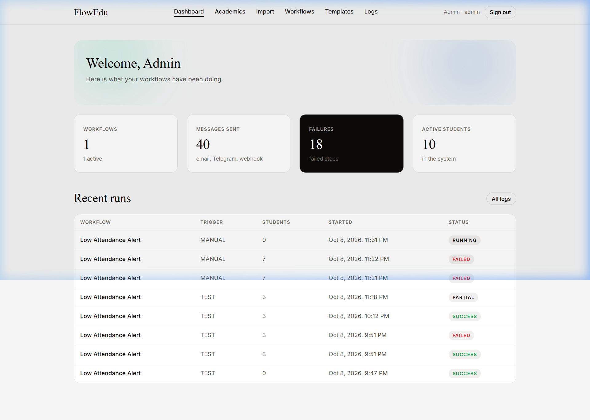
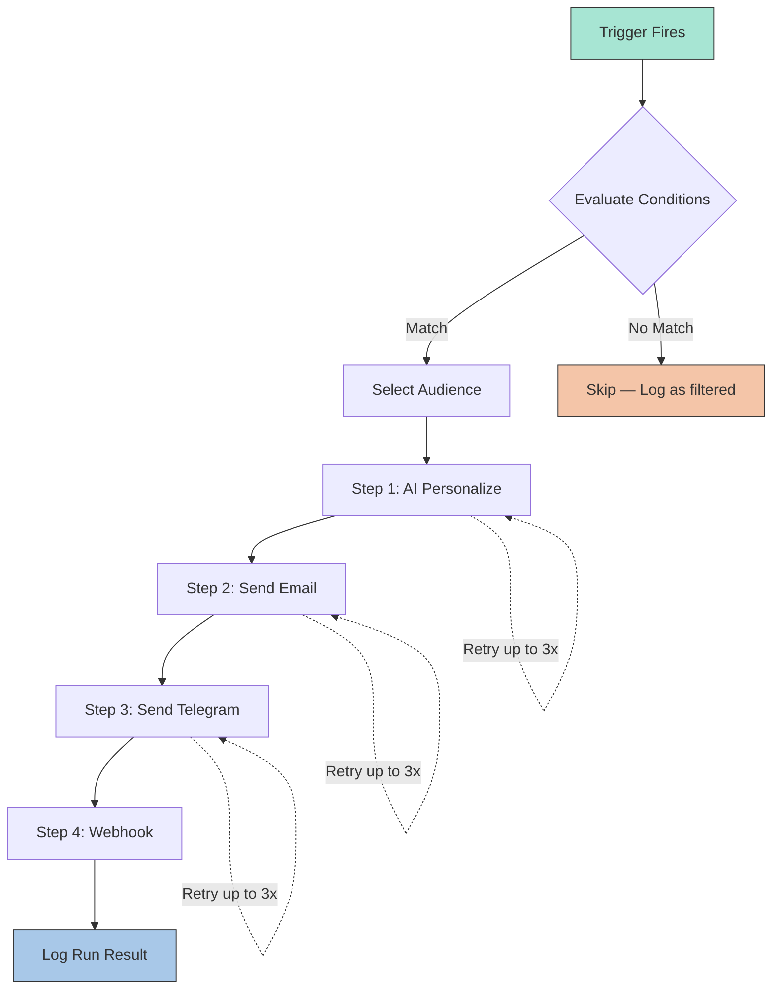

<p align="center">
  
</p>

<h1 align="center">🎓 FlowEdu</h1>
<h3 align="center">Intelligent Workflow Automation for Educational Institutions</h3>

<p align="center">
  
  
  
  
  
  
  <a href="https://github.com/shubhydv334-alt/FlowEdu/actions/workflows/ci.yml"></a>
</p>

<p align="center">
  FlowEdu is a full-stack, production-ready workflow automation platform designed for colleges and universities. Build visual automation workflows that trigger on academic events — like low attendance, upcoming exams, or assignment deadlines — and automatically send personalized AI-generated notifications via <strong>Email</strong>, <strong>Telegram</strong>, and <strong>Webhooks</strong>.
</p>

---

## ✨ Key Features

### 📊 Smart Dashboard with Analytics
- At-a-glance KPI cards: total workflows, messages sent, failures, active students
- Interactive SVG charts: workflow runs over time, message channel breakdown, step success/failure trends, and run status distribution
- Recent workflow runs table with status badges

### 🔧 Visual Workflow Builder
- Drag-and-drop style builder for creating complex automations
- **Triggers**: event-based (attendance uploaded, assignment submitted), cron-scheduled, or date-based (X days before exam/deadline)
- **Conditions**: filter students by attendance %, department, semester, section, batch, course, and more
- **Audience targeting**: narrow down to specific departments, semesters, or sections
- **Multi-step pipelines**: chain AI → Email → Telegram → Webhook steps in any order
- **Template variables**: `{{student.name}}`, `{{attendance.percent}}`, `{{ai.message}}` with fallback syntax `{{var|default}}`

### 🤖 AI-Powered Personalization
- Built-in AI step using **Google Gemini**, **Groq**, or **OpenRouter** (all free tier)
- Automatic failover: tries Gemini → Groq → OpenRouter → plain text fallback
- **Pollinations** option for demos (no key required)
- Generates personalized, empathetic messages per student based on their academic data

### 📬 Multi-Channel Notifications
- **Email** via SMTP (Gmail supported out of the box)
- **Telegram** bot integration with per-student chat delivery
- **Webhooks** for custom integrations (Slack, Discord, CRMs, etc.)
- All channels gracefully degrade to `SIMULATED` mode when keys aren't configured

### 📁 CSV Data Import
- Import **students**, **attendance**, and **marks** via CSV upload
- Preview import with validation before committing
- Error reporting with row-level details
- Auto-creates departments, courses, and sections on import

### 🎯 One-Click Templates
- **Low Attendance Alert** — AI-personalized warnings for students below threshold
- **Assignment Deadline Reminder** — countdown notifications before due dates
- **Exam Countdown** — automated reminders as exam dates approach
- **Weekly Teacher Digest** — summary reports for faculty
- Use any template as a starting point, customize in the builder

### 📋 Execution Logs & Debugging
- Full execution history with expandable run details
- Per-step logs showing input/output JSON, attempts, and errors
- Status tracking: `SUCCESS`, `SIMULATED`, `PREVIEW`, `FALLBACK`, `FAILED`
- 3 automatic retries with exponential backoff on failures

### 🔐 Role-Based Access Control
- Three roles: **Admin**, **Teacher**, **Student**
- JWT-based authentication with secure route guards
- Role-restricted pages and API endpoints
- One-click demo login buttons for quick testing

### 🎨 Premium Design System
- Design language inspired by ElevenLabs, implemented independently with custom tokens and components (not affiliated with or endorsed by ElevenLabs)
- Atmospheric gradient orbs, glassmorphism effects
- Responsive layout that works on desktop and mobile
- Style guide available at `/styleguide`

---

## 🏗️ Architecture

```
┌──────────────────────────────────────────────────────┐
│                    React Frontend                     │
│  (Vite + React Router + Custom SVG Charts)           │
│  Port 5173 ──── proxies /api ────► Port 8080         │
└──────────────────────────────────────────────────────┘
                         │
                    REST API (JSON)
                         │
┌──────────────────────────────────────────────────────┐
│                 Spring Boot Backend                   │
│                                                      │
│  ┌─────────────┐  ┌──────────────┐  ┌────────────┐  │
│  │   Auth &    │  │   Workflow   │  │  Academic   │  │
│  │  Security   │  │   Engine     │  │  Data Mgmt  │  │
│  │  (JWT)      │  │  (Triggers,  │  │  (CSV       │  │
│  │             │  │   Actions)   │  │   Import)   │  │
│  └─────────────┘  └──────────────┘  └────────────┘  │
│                                                      │
│  ┌─────────────┐  ┌──────────────┐  ┌────────────┐  │
│  │   AI Step   │  │    Email /   │  │  Insights  │  │
│  │  (Gemini,   │  │  Telegram /  │  │  & Charts  │  │
│  │   Groq)     │  │   Webhook    │  │  Dashboard │  │
│  └─────────────┘  └──────────────┘  └────────────┘  │
│                         │                            │
│               ┌─────────┴─────────┐                  │
│               │   H2 / PostgreSQL │                  │
│               │   (JPA + Hibernate)│                  │
│               └───────────────────┘                  │
└──────────────────────────────────────────────────────┘
```

---

## 🚀 Quick Start

### Prerequisites
- **Java 17+** (JDK)
- **Maven 3.8+**
- **Node.js 18+** and npm

### 1. Clone & Configure

```bash
git clone https://github.com/shubhydv334-alt/FlowEdu.git
cd FlowEdu

# Copy the environment template (all keys are optional — app works without them)
cp .env.example .env
# Optionally fill in API keys for AI, Email, Telegram (see Configuration below)
```

### 2. Start the Backend

```bash
cd backend
./run.sh    # Loads ../.env, runs mvn spring-boot:run
            # Embedded H2 database — zero setup required
            # Demo data seeded automatically on first start
```

> **Windows?** Run `bash run.sh` in Git Bash, or set the env vars manually and run `mvn spring-boot:run`.

### 3. Start the Frontend

```bash
cd frontend
npm install
npm run dev    # Starts at http://localhost:5173
               # Proxies /api → http://localhost:8080
```

### 4. Open in Browser

Navigate to **http://localhost:5173** and use any demo login:

| Role | Email | Password |
|------|-------|----------|
| 🔑 Admin | `admin@flowedu.local` | `admin123` |
| 👩‍🏫 Teacher | `teacher@flowedu.local` | `teacher123` |
| 🎓 Student | `student@flowedu.local` | `student123` |

> One-click preset buttons on the login page make this even easier!
>
> These accounts are created only when `SEED_DEMO_DATA` is `true` (the default for local development). Disable them before deploying, see [Production Deployment](#-production-deployment).

---

## 🎬 Demo Walkthrough (2 minutes)

1. **Templates** → Select *Low Attendance Alert* → Click **Use template** → Opens in the builder
2. Click **Preview (sends nothing)** → See the AI step, email, and Telegram rendered for sample students
3. Click **Save and enable** to activate the workflow
4. **Import** → Choose *Attendance* → Upload `sample-data/attendance.csv` → **Preview** → **Import**
5. Open **Logs** → A new run appears → Expand it to see every step's input and output

### Safe Demo Mode

Without API keys, everything still works:
- ✅ **No `MAIL_HOST`** → Emails logged as `SIMULATED`
- ✅ **No `TELEGRAM_TOKEN`** → Telegram messages logged as `SIMULATED`
- ✅ **No AI key** → AI step uses plain text fallback (`FALLBACK`)

---

## ⚙️ Configuration

All environment variables are optional. Set them in `.env`:

| Variable | Purpose |
|----------|---------|
| `AI_PROVIDER` | AI engine: `auto` (default), `gemini`, `groq`, `openrouter`, `pollinations` |
| `GEMINI_API_KEY` | Google AI Studio key ([get one free](https://aistudio.google.com/apikey)) |
| `GROQ_API_KEY` | Groq API key ([get one free](https://console.groq.com/keys)) |
| `OPENROUTER_API_KEY` | OpenRouter key ([get one free](https://openrouter.ai/keys)) |
| `TELEGRAM_TOKEN` | Telegram bot token (from @BotFather) |
| `TEST_TELEGRAM_CHAT_ID` | Your chat ID for "Send test to me" |
| `MAIL_HOST`, `MAIL_PORT` | SMTP server and port (default port `587`). Leave `MAIL_HOST` unset to keep email in `SIMULATED` mode |
| `MAIL_USER`, `MAIL_PASS` | SMTP credentials (Gmail App Password) |
| `MAIL_FROM` | Sender email address |
| `DB_URL`, `DB_USER`, `DB_PASS` | Use PostgreSQL/MySQL instead of the embedded H2 file database |
| `DDL_AUTO` | Hibernate schema handling: `update` (default), `validate` or `none` |
| `JWT_SECRET` | JWT signing secret, 32+ characters. The `prod` profile refuses placeholder values |
| `CORS_ORIGIN` | Browser origin allowed to call the API (default `http://localhost:5173`) |
| `SEED_DEMO_DATA` | Create demo users and sample data on first start (default `true`; `false` under `prod`) |
| `ADMIN_EMAIL`, `ADMIN_PASSWORD` | Create this administrator on startup if it does not exist (password 12+ characters) |
| `ALLOW_PRIVATE_WEBHOOKS` | Allow webhooks to loopback/private addresses, local testing only (default `false`) |
| `DATE_TRIGGER_CRON` | When date-based workflows run (default: `0 0 9 * * *`) |
| `PORT` | Backend listen port (default `8080`) |
| `SPRING_PROFILES_ACTIVE` | Set to `prod` for production, see [Production deployment](#-production-deployment) |
| `WEB_PORT` | Host port of the web UI in `docker-compose.yml` (default `8080`) |

### AI Provider Cascade

With `AI_PROVIDER=auto` (default), the AI step automatically tries:

```
Gemini → Groq → OpenRouter → Plain text fallback
```

If one provider is rate-limited or down, it seamlessly moves to the next. A free-tier limit **never stops a workflow**.

---

## 🐳 Production Deployment

The repository ships a Docker Compose stack: PostgreSQL, the Spring Boot API (with the `prod` profile) and an nginx container that serves the React build and proxies `/api` to the backend.

```bash
cp .env.example .env
# Edit .env and set at least:
#   DB_PASS         database password
#   JWT_SECRET      32+ random characters, e.g. `openssl rand -base64 48`
#   ADMIN_EMAIL     first administrator
#   ADMIN_PASSWORD  12+ characters
#   CORS_ORIGIN     public URL of the web UI (only needed if the API is called from another origin)
docker compose up --build -d
```

Open **http://localhost:8080** (change with `WEB_PORT`) and sign in with the administrator you configured. Demo data is off by default in this stack.

- The backend refuses to start under `SPRING_PROFILES_ACTIVE=prod` when `DB_URL`, `DB_USER`, `DB_PASS`, `JWT_SECRET` or `CORS_ORIGIN` are missing, or when `JWT_SECRET` is still a placeholder.
- Health check: `GET /actuator/health` (used by the container health check, no authentication).
- Terminate TLS in front of the stack (reverse proxy or load balancer) and keep the database port unpublished, as the compose file does.
- Back up the `db-data` volume. The schema is created and updated by Hibernate (`DDL_AUTO=update`); there are no migration scripts yet, so review schema changes before upgrading.
- Run a **single backend instance**: scheduled triggers run inside every instance, and the login throttle is kept in memory per instance.

Without Docker, build and run the jar yourself:

```bash
cd backend
mvn -DskipTests package
SPRING_PROFILES_ACTIVE=prod DB_URL=... DB_USER=... DB_PASS=... JWT_SECRET=... CORS_ORIGIN=... \
  java -jar target/flowedu-0.1.0.jar
```

---

## 🔒 Security Notes

- **Demo accounts** (`admin@flowedu.local` and friends) exist only while `SEED_DEMO_DATA` is `true`. Never expose an instance that still has them; use `ADMIN_EMAIL` / `ADMIN_PASSWORD` instead.
- **Secrets** live in environment variables only. `.env` is git-ignored, the `.env.example` placeholders are rejected by the `prod` profile, and API keys and bot tokens are masked in step logs and error messages.
- **Sign-in throttling**: five failed attempts for the same email and client address block further attempts for 15 minutes (in memory, per instance).
- **Webhooks** may not target loopback, private, link-local or cloud-metadata addresses (SSRF protection). `ALLOW_PRIVATE_WEBHOOKS=true` lifts this for local testing. DNS answers are checked before the request, so also restrict the server's outbound network where you can.
- **Sessions** use signed JWTs that expire after 12 hours and are stored by the browser in `localStorage`; the role is read from the token, so a role change takes effect at the next sign-in.
- **Errors** returned to clients never include stack traces or exception messages from unexpected failures; details are written to the server log.

Found a vulnerability? See [SECURITY.md](SECURITY.md).

---

## 🧱 Project Structure

```
FlowEdu/
├── backend/                          # Spring Boot 3 (Java 17)
│   ├── src/main/java/com/flowedu/
│   │   ├── FlowEduApplication.java   # Entry point
│   │   ├── Domain.java               # JPA entities (User, Student, Workflow, Run, StepLog, etc.)
│   │   ├── Repos.java                # Spring Data repositories
│   │   ├── SecurityConfig.java       # JWT security configuration
│   │   ├── AuthController.java       # Login & JWT issuance
│   │   ├── AcademicController.java   # Departments, courses, students, sections
│   │   ├── ImportController.java     # CSV upload endpoint
│   │   ├── ImportService.java        # CSV parsing with validation & preview
│   │   ├── WorkflowController.java   # CRUD for workflows
│   │   ├── WorkflowService.java      # Workflow business logic
│   │   ├── WorkflowEngine.java       # Execution engine with retry & logging
│   │   ├── Triggers.java             # Event, cron & date-based trigger handlers
│   │   ├── Actions.java              # Email, Telegram, Webhook, AI action implementations
│   │   ├── InsightsController.java   # Dashboard & chart data APIs
│   │   ├── TemplateController.java   # One-click workflow templates
│   │   ├── DataSeeder.java           # Demo data seeding (opt out with SEED_DEMO_DATA=false)
│   │   ├── AdminBootstrap.java       # First admin from ADMIN_EMAIL / ADMIN_PASSWORD
│   │   ├── LoginAttemptLimiter.java  # Brute-force protection for /api/auth/login
│   │   ├── UrlGuard.java             # SSRF protection for webhook targets
│   │   └── ApiErrors.java            # Consistent JSON error responses
│   ├── src/main/resources/           # application.yml and application-prod.yml
│   ├── src/test/                     # JUnit tests and the test profile
│   ├── Dockerfile                    # Multi-stage backend image
│   ├── run.sh                        # Start script (loads .env)
│   └── pom.xml
│
├── frontend/                         # React 18 + Vite 5
│   ├── src/
│   │   ├── main.jsx                  # App entry
│   │   ├── App.jsx                   # Router & layout
│   │   ├── ui.jsx                    # Reusable UI components
│   │   ├── charts.jsx                # SVG chart components (Bar, Donut, Area)
│   │   ├── api.js                    # API client with JWT
│   │   ├── auth.jsx                  # Auth context & hooks
│   │   ├── meta.js                   # Constants & formatters
│   │   ├── tokens.css                # Design tokens
│   │   ├── components.css            # Component styles
│   │   ├── charts.css                # Chart styles
│   │   ├── app.css                   # Layout styles
│   │   └── pages/
│   │       ├── Dashboard.jsx         # Dashboard with stats & charts
│   │       ├── Academics.jsx         # Academic data management
│   │       ├── ImportPage.jsx        # CSV import with preview
│   │       ├── Workflows.jsx         # Workflow listing
│   │       ├── WorkflowBuilder.jsx   # Visual workflow builder
│   │       ├── Templates.jsx         # One-click templates
│   │       ├── Logs.jsx              # Execution logs
│   │       └── Login.jsx             # Authentication
│   ├── Dockerfile, nginx.conf        # Static build served by nginx, /api proxied to the backend
│   └── package.json
│
├── sample-data/                      # Demo CSV files
│   ├── students.csv
│   ├── attendance.csv
│   └── marks.csv
│
├── docs/
│   ├── DESIGN-elevenlabs.md          # Design system specification
│   └── screenshots/
│       └── dashboard.png
│
├── .github/                          # CI workflow and Dependabot configuration
├── docker-compose.yml                # PostgreSQL + API + web
├── .env.example                      # Environment template (no secrets)
├── .gitignore
└── README.md
```

---

## 🧪 Testing and CI

```bash
# Backend: unit tests and MockMvc integration tests on an in-memory H2 database
cd backend && mvn verify

# Frontend: lint, unit/component tests, production build
cd frontend && npm ci && npm run lint && npm test && npm run build
```

The GitHub Actions workflow in `.github/workflows/ci.yml` runs the same checks on every push and pull request, then builds both Docker images and validates `docker-compose.yml`. Dependabot proposes dependency updates weekly.

---

## 🔄 Workflow Engine — How It Works



### Trigger Types
| Type | Description | Example |
|------|-------------|---------|
| **Event** | Fires when academic data is uploaded | Attendance uploaded → alert low-attendance students |
| **Schedule** | Cron-based recurring execution | Every Monday at 8 AM → send weekly digest |
| **Date** | Countdown to a specific date | 3 days before exam → send reminder |

### Action Types
| Action | Description |
|--------|-------------|
| 🤖 **AI** | Generate personalized message using LLM (Gemini/Groq/OpenRouter) |
| 📧 **Email** | Send via SMTP with HTML templates |
| 💬 **Telegram** | Send via Telegram Bot API |
| 🔗 **Webhook** | POST JSON to any URL |

---

## 📝 Development Phases

| Phase | Features | Key Files |
|-------|----------|-----------|
| **0** | Design system — tokens, components, style guide (`/styleguide`) | `tokens.css`, `components.css`, `ui.jsx` |
| **1** | JWT authentication, role-based access (Admin/Teacher/Student) | `JwtService`, `SecurityConfig`, `AuthController` |
| **2** | Academic data management, CSV import with preview & validation | `AcademicController`, `ImportService` |
| **3** | Visual workflow builder — triggers, conditions, audience, steps | `WorkflowService`, `WorkflowBuilder.jsx` |
| **4** | Execution engine — event, cron, date triggers; multi-channel delivery | `WorkflowEngine`, `Triggers`, `Actions` |
| **5** | Reliability — execution logs, 3x retry with backoff, preview mode | `WorkflowEngine.Worker`, `Logs.jsx` |
| **6** | Education workflows — attendance alerts, digests, exam countdown | `TemplateController` |
| **7** | AI integration — multi-provider with auto-failover, templates | `Actions.AiAction` |
| **8** | Dashboard — KPI cards, interactive charts, analytics | `InsightsController`, `Dashboard.jsx`, `charts.jsx` |
| **9** | Polish — seed data, sample CSVs, empty states, responsive UI | `DataSeeder`, `sample-data/` |

---

## 🛠️ Extending FlowEdu

### Adding a New Action Type

1. Implement the `Action` interface:
```java
@Component
public class SlackAction implements Action {
    public String type() { return "SLACK"; }
    public ActionResult execute(Map<String, Object> config, Map<String, Object> context) {
        // Send Slack message using config and context variables
        return ActionResult.success("Sent to #channel");
    }
}
```
2. The engine auto-discovers it via Spring's `@Component` scanning.

### Condition Operators
`<` `<=` `>` `>=` `==` `!=` `contains`

Numbers are compared numerically; everything else is case-insensitive text.

### Cron Format
Spring's 6-field format: `second minute hour day month weekday`

Example: `0 0 9 * * MON` = Every Monday at 9:00 AM

---

## 🗺️ Roadmap

- [ ] Marks-based workflows (GPA alerts, grade warnings)
- [ ] Fee reminder automation
- [ ] Bulk announcement broadcasts
- [ ] Parent notification channel
- [ ] Teacher & student personalized dashboards
- [ ] Conditional branching in workflows
- [ ] At-risk student detection & alerts
- [ ] Approval workflows (admin sign-off before sending)
- [ ] Plugin connector marketplace
- [ ] Audit log & compliance reporting
- [ ] JSON import/export for workflows

---

## 📄 License

This project is open-source under the [MIT License](LICENSE).

---

<p align="center">
  Built with ❤️ for educational institutions everywhere
</p>
